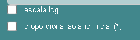
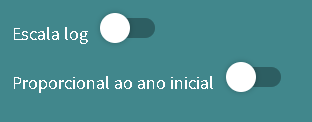
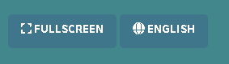

# Tutorial: Novo UI dos Apps Shiny — Material Switch, Spinner e Lang Toggle

Este tutorial explica como implementar as três atualizações de UI que estão sendo padronizadas nos apps do Data Zoom Amazônia. Os exemplos de referência são os apps `ts_rais`, `ts_comex_exp_tot_pais` e `ts_energia_sistemas_isolados`, que já têm tudo implementado.

---

## Índice

1. [Substituir `selectInput`/`checkboxInput` por `materialSwitch`](#1-substituir-selectinput--checkboxinput-por-materialswitch)
2. [Adicionar spinner com `withSpinner`](#2-adicionar-spinner-com-withspinner)
3. [Criar o botão de lang toggle](#3-criar-o-botão-de-lang-toggle)
4. [Toggle de agregação com `actionButton` (segmented control)](#4-toggle-de-agregação-com-actionbutton-segmented-control)
5. [Inversão de eixos (swap / transposição)](#5-inversão-de-eixos-swap--transposição)

---

## 1. Substituir `checkboxInput` por `materialSwitch`

O `materialSwitch` é um toggle visual (on/off) do pacote **`shinyWidgets`**. Ele substitui checkboxes e selects binários (sim/não, log/linear, etc.) por um switch mais moderno e legível no fundo verde do menu.

### Quando usar

Use `materialSwitch` sempre que o input tiver apenas **dois estados** — por exemplo:
- Escala logarítmica
- Proporcional ao ano inicial
- Deflacionar

Para inputs com múltiplas opções (ex: escolha de variável), continue usando `selectInput` ou `selectizeInput`.

### Visual: antes e depois

| Antes (checkboxInput) | Depois (materialSwitch) |
|---|---|
|  |  |

### Passo a passo

**1. Adicionar o pacote no arquivo do app (ex: `app_ts_meuapp.R`)**

```r
library(shinyWidgets)
```

**2. Adicionar o CSS de cor do label no `ui.R`**

O label do switch precisa ficar branco para aparecer sobre o fundo verde do menu. Adicione esta linha **uma única vez** em qualquer lugar dentro do `div()` principal da UI:

```r
tags$style(HTML(".switch-label { color: white; }"))
```

**3. Substituir o input antigo pelo `materialSwitch`**

**Antes** (usando `checkboxInput`):
```r
checkboxInput(
    inputId = "ylog",
    label   = param$label_scale_name,
    value   = FALSE
)
```

**Depois** (usando `materialSwitch`):
```r
div(
    style = "margin-top: 10px;",
    materialSwitch(
        inputId = "ylog",
        label   = tags$span(param$label_scale_name, class = "switch-label"),
        value   = FALSE,
        status  = "info"
    )
)
```

> **O que mudou:**
> - O `label` agora é um `tags$span()` com a classe `switch-label` — isso aplica o CSS branco que adicionamos.
> - `status = "info"` define a cor do switch quando ativado (azul do Bootstrap). Não mude isso.
> - O `div(style = "margin-top: 10px;")` é para dar um respiro visual entre os switches.

**Exemplo real** — trecho do `scripts/ts_comex_exp_tot_pais/ui.R`:
```r
# CSS do label (adicionar uma vez)
tags$style(HTML(".switch-label { color: white; }")),

# Switch de escala log
div(
    style = "margin-top: 10px;",
    materialSwitch(
        inputId = "ylog",
        label   = tags$span(param$label_scale_name, class = "switch-label"),
        value   = FALSE,
        status  = "info"
    )
),

# Switch proporcional
div(
    style = "margin-top: 10px;",
    materialSwitch(
        inputId = "y_option",
        label   = tags$span(param$label_axis_name, class = "switch-label"),
        value   = FALSE,
        status  = "info"
    )
),
```

### No server — nada muda

O `materialSwitch` retorna `TRUE` ou `FALSE` igual ao `checkboxInput`. Todo código no `server.R` que usava `input$ylog` continua funcionando sem nenhuma alteração.

---

## 2. Adicionar spinner com `withSpinner`

O `withSpinner` exibe uma animação de carregamento enquanto o gráfico ainda está sendo renderizado. Ele vem do pacote **`shinycssloaders`**.

### Passo a passo

**1. Adicionar o pacote no arquivo do app**

```r
library(shinycssloaders)
```

**2. Ajustar o `div` do plot no `ui.R`**

O `withSpinner` envolve o output do gráfico. Mas para funcionar bem, o `div` que contém o plot precisa ter `display: flex` e `flex-direction: column`, e o `height` do gráfico precisa ser absoluto (em `vh`) em vez de `"100%"`.

**Antes:**
```r
div(
    class = "plotdiv w-100 h-100",
    plotlyOutput("plot", width = "100%", height = "100%")
)
```

**Depois:**
```r
div(
    class = "plotdiv w-100 h-100",
    style = "position: relative; display: flex; flex-direction: column;",
    div(
        style = "flex-grow: 1; position: relative;",
        withSpinner(
            plotlyOutput("plot", width = "100%", height = "calc(100vh - 150px)"),
            type  = 4,
            color = "#41878C"
        )
    )
)
```

> **O que mudou:**
> - O `div` externo ganha `display: flex; flex-direction: column;` para o layout funcionar.
> - Um `div` interno com `flex-grow: 1` garante que o spinner ocupe o espaço disponível.
> - O `height` do `plotlyOutput` muda de `"100%"` para `"calc(100vh - 150px)"` — isso é necessário porque o spinner precisa de uma altura definida para aparecer corretamente.
> - O estilo do spinner `type = 4` (círculo girando) e o verde-azulado `color = "#41878C"` são o padrão dos nossos apps.

---

## 3. Criar o botão de lang toggle

O lang toggle é um `actionButton` que alterna o idioma do app entre PT e EN **sem recarregar a página**. É a nova abordagem que substitui o sistema antigo de ter dois apps separados (`app_meuapp.R` e `app_meuapp_en.R`).

A lógica funciona assim:
1. O app tem **um único arquivo** (sem versão `_en`)
2. `param$i18n` guarda todos os textos em PT e EN (i18n é a abreviação padrão em desenvolvimento de software para "internationalization")
3. Um `reactiveVal("pt")` controla o idioma ativo
4. Quando o botão é clicado, o idioma muda e os textos atualizam

### Passo a passo

#### 3.1 — No arquivo do app (ex: `app_ts_meuapp.R`)

**Antes** (abordagem antiga com dois arquivos):
```r
param$lang <- FALSE  # ou TRUE no arquivo _en.R
files$param_file <- "../data/meu_app_dic.csv"
files$db_file       <- "../data/meuapp.rds"
...
param <- get_db_param(files$param_file, files$db_file) # carrega lista de variáveis e parâmetros
```

**Depois** (nova abordagem com toggle):

Passe a chamar dois arquivos de dicionário (PT e EN) e monte o `param$i18n`:

```r
# SEM param$lang

files$param_file_pt <- "../data/meuapp_dic.csv"
files$param_file_en <- "../data/meuapp_dic_en.csv"
files$db_file       <- "../data/meuapp.rds"

param_pt <- get_db_param(files$param_file_pt, files$db_file)
param_en <- get_db_param(files$param_file_en, files$db_file)

param        <- param_pt           # PT como idioma padrão
param$tables <- list(
    pt = param_pt$table,
    en = param_en$table
)

# Todos os textos que aparecem na UI, em PT e EN:
param$i18n <- list(
    pt = list(
        plot_desc        = "Descrição do app em português",
        label_var_name   = "VARIÁVEIS:",
        label_y_name     = "Eixo vertical (y)",
        label_scale_name = "Escala log",
        label_prop_name  = "Proporcional ao ano inicial",
        btn_lang         = "English",     # label do botão quando app está em PT
        btn_fullscreen   = "Fullscreen"
    ),
    en = list(
        plot_desc        = "App description in English",
        label_var_name   = "VARIABLES:",
        label_y_name     = "Vertical axis (y)",
        label_scale_name = "Log scale",
        label_prop_name  = "Proportional to starting year",
        btn_lang         = "Português",   # label do botão quando app está em EN
        btn_fullscreen   = "Fullscreen"
    )
)
```

> **Dica:** O `btn_lang` sempre mostra o **idioma de destino**, não o atual. Quando o app está em PT, o botão mostra "English". Quando está em EN, mostra "Português".

#### 3.2 — No `ui.R`

Adicione o botão de lang toggle na sidebar, antes do botão de Fullscreen:

```r
# Botão de troca de idioma
actionButton(
    inputId = "toggle_lang",
    label   = "English",
    icon    = icon("globe"),
    class   = "btn-primary"
),

div(style = "height: 6px;"),   # espaço entre os botões

# Botão de fullscreen (já existente)
actionButton(
    inputId = "ab1",
    label   = "Fullscreen",
    icon    = icon("expand"),
    class   = "btn-primary",
    onclick = paste0("window.open('", param$link, "', '_blank')")
),
```

Os textos que mudam de idioma (título, descrição, labels) devem ser renderizados via `textOutput()` / `uiOutput()` em vez de valores fixos de `param`:

```r
# No lugar de:  h2(class = "plot_name", param$plot_name)
# Use:          uiOutput("plot_name_ui")

uiOutput("plot_name_ui"),
uiOutput("plot_desc_ui"),
hr(),
p(class = "vars", textOutput("label_var_name", inline = TRUE)),
```

O resultado final fica assim na sidebar:



#### 3.3 — No `server.R`

Adicione a lógica de lang **antes** dos outros outputs e observadores:

```r
get_server <- function(files, param) {
  function(input, output, session) {

    # --- LANG TOGGLE ---

    # Reativo que guarda o idioma atual ("pt" ou "en")
    lang <- reactiveVal("pt")

    # Troca o idioma quando o botão é clicado
    observeEvent(input$toggle_lang, {
        lang(ifelse(lang() == "pt", "en", "pt"))
    })

    # Atalho para os textos do idioma ativo
    i18n <- reactive({ param$i18n[[lang()]] })

    # Renderiza os textos dinâmicos da sidebar
    output$plot_name_ui  <- renderUI({ h2(class = "plot_name", param$plot_name) })
    output$plot_desc_ui  <- renderUI({ p(class = "plot_desc", i18n()$plot_desc) })
    output$label_var_name <- renderText({ i18n()$label_var_name })

    # Atualiza inputs e botões quando o idioma muda
    observeEvent(lang(), {

        # Atualiza as choices do selectInput com a tabela traduzida
        tbl <- param$tables[[lang()]]
        updateSelectInput(
            session,
            "y",
            label    = i18n()$label_y_name,
            choices  = setNames(tbl$var[tbl$y], tbl$label[tbl$y]),
            selected = isolate(input$y)
        )

        # Atualiza o label dos switches
        # (o texto do label é um textOutput, então atualiza automaticamente via i18n())

        # Atualiza o label dos botões
        updateActionButton(session, "toggle_lang", label = i18n()$btn_lang)
        updateActionButton(session, "ab1",         label = i18n()$btn_fullscreen)
    }, ignoreInit = FALSE)

    # --- RESTO DO SERVER (plots, filtros, etc.) ---
    # ... código existente continua aqui ...
  }
}
```

> **Detalhe importante:** `ignoreInit = FALSE` no `observeEvent(lang(), ...)` garante que os choices e labels sejam populados corretamente logo no carregamento inicial do app, mesmo sem o usuário clicar no botão.

#### 3.4 — Como o `materialSwitch` interage com o lang toggle

Quando o label do switch é um `textOutput`, ele atualiza automaticamente:

```r
# No ui.R — label dinâmico via textOutput
materialSwitch(
    inputId = "ylog",
    label   = tags$span(textOutput("label_scale_name", inline = TRUE), class = "switch-label"),
    value   = FALSE,
    status  = "info"
)

# No server.R — renderiza o texto do label
output$label_scale_name <- renderText({ i18n()$label_scale_name })
```

---

## 4. Toggle de agregação com `actionButton` (segmented control)

Quando um input tem **dois estados que não são "ligado/desligado"** — e sim duas alternativas de igual peso (Estado vs. Município, SH2 vs. SEC) — o `materialSwitch` fica ambíguo: não dá para rotular os dois lados. Nesses casos usamos um **segmented control**: dois `actionButton` lado a lado, um deles sempre destacado como ativo.

Apps de referência: `ts_mapbiomas_cobertura` (Estado/Município) e `ts_comex_exp_municipio` (SH2/SEC).

### Por que não `materialSwitch` nem `radioButtons`

- `materialSwitch` só tem um label — não comunica "estou escolhendo entre A e B".
- `radioButtons` funciona, mas visualmente destoa do resto da sidebar (fundo verde, botões estilizados).
- Dois `actionButton` usam o binding nativo do Shiny (sempre confiável), estilizados como um único controle segmentado com CSS.

### O CSS já está no global

As classes `.seg-toggle`, `.seg-btn` e `.seg-active` vivem no `global/dza_lumen.css` (seção "Custom CSS", junto com `.menucol`, `.sidebar-gap` etc.). **Não** replique esse CSS em cada `ui.R` — como o app já inclui o CSS global via `includeCSS(files$CSS_script)`, basta usar as classes. Só o handler JS entra no `ui.R`, porque ele referencia os **IDs dos botões**, que são específicos de cada app.

### Passo a passo

**1. No `ui.R` — handler JS de destaque**

Cole só o handler (sem `tags$style`). Ele aplica a classe `.seg-active` ao botão do estado atual quando o server envia a mensagem `setGeo`:

```r
tags$script(HTML(
  "Shiny.addCustomMessageHandler('setGeo', function(v){
     var a = document.getElementById('geo_est');
     var b = document.getElementById('geo_munic');
     if (a) a.classList.toggle('seg-active', v === 'est');
     if (b) b.classList.toggle('seg-active', v === 'munic');
   });"
)),
```

> Para um toggle com outra semântica (ex: SH2/SEC), troque o nome da mensagem (`setAgg`), os IDs (`agg_sh2`/`agg_sec`) e os valores comparados — mas **mantenha as classes `.seg-*`**, que são compartilhadas.

**2. No `ui.R` — os dois botões**

Um label acima (via `textOutput`, para acompanhar o idioma) e os dois botões dentro do `div.seg-toggle`. O botão que começa ativo já leva a classe `seg-active`:

```r
div(
  tags$div(class = "switch-label", style = "margin-bottom: 4px;",
           textOutput("label_agg", inline = TRUE)),
  div(
    class = "seg-toggle",
    actionButton("geo_est", textOutput("label_geo_est", inline = TRUE),
                 class = "btn-primary seg-btn seg-active"),
    actionButton("geo_munic", textOutput("label_geo_munic", inline = TRUE),
                 class = "btn-primary seg-btn")
  )
),
```

**3. No `server.R` — `reactiveVal` + observers**

O estado vira um `reactiveVal` (não um `input$` booleano). Cada botão só escreve o seu valor; um observer envia a mensagem de destaque de volta pro cliente:

```r
# Lê o valor inicial da URL (permite deep-link) e cai em "est" por padrão
geo <- reactiveVal({
  query <- parseQueryString(isolate(session$clientData$url_search))
  if (identical(query[["geo"]], "munic")) "munic" else "est"
})
observeEvent(input$geo_est,   { geo("est") })
observeEvent(input$geo_munic, { geo("munic") })

# Sincroniza o destaque do botão ativo (client-side).
# ignoreInit = FALSE => destaca o botão certo já no carregamento.
observeEvent(geo(), {
  session$sendCustomMessage("setGeo", geo())
}, ignoreInit = FALSE)

# Daqui pra frente use geo() como qualquer reactive:
df <- reactive({ if (geo() == "munic") df_munic else df_est })
```

Os labels dos botões são `textOutput`, renderizados a partir do `i18n()` (seção 3), então traduzem sozinhos no lang toggle:

```r
output$label_agg       <- renderText({ i18n()$label_agg })
output$label_geo_est   <- renderText({ i18n()$label_geo_name$est })
output$label_geo_munic <- renderText({ i18n()$label_geo_name$munic })
```

> **Cuidado com persistência:** trocar de agregação **não deve** resetar as outras seleções. Se as duas agregações compartilham as mesmas opções de eixo Y (mesmo caso do `ts_mapbiomas_cobertura`, em que Estado e Município têm as mesmas classes), guarde a seleção num `reactiveVal` e restaure-a no `observeEvent(geo(), ...)` em vez de sortear de novo:
> ```r
> kept_y <- reactiveVal(NULL)
> observeEvent(input$y, {
>   if (!is.null(input$y) && input$y != "") kept_y(input$y)
> }, ignoreInit = TRUE)
>
> observeEvent(geo(), {
>   ky <- isolate(kept_y())
>   if (!is.null(ky) && ky != "") {
>     updateSelectInput(session, "y", choices = y_choices_lang(), selected = ky)
>   }
> }, ignoreInit = TRUE)
> ```

---

## 5. Inversão de eixos (swap / transposição)

Alguns apps deixam o usuário **inverter os papéis dos eixos**: o que estava no eixo Y (a "entidade fixada") passa a ser a série comparada, e vice-versa. No `ts_comex_exp_municipio` isso permite ver *"um município → seus produtos"* ou *"um produto → seus municípios"* com o mesmo botão.

App de referência: `ts_comex_exp_municipio` (branch `comex-merging-apps`).

### A ideia central: um dataset por orientação

Transpor no servidor a cada clique é caro e frágil. Em vez disso, **pré-computamos um `.rds` para cada orientação** no script de `data-raw/` e trocamos qual está ativo. Combinado com o toggle de agregação da seção 4, o `ts_comex_exp_municipio` mantém **quatro** recortes:

```r
dfs <- list(
  munic_sh2 = readRDS(files$db_file_munic_sh2), # group = produto (SH2), y = município
  sh2_munic = readRDS(files$db_file_sh2_munic), # group = município,   y = produto (SH2)
  munic_sec = readRDS(files$db_file_munic_sec), # group = produto (SEC), y = município
  sec_munic = readRDS(files$db_file_sec_munic)  # group = município,   y = produto (SEC)
)
```

O `mode` ativo é a combinação **orientação × agregação**:

```r
orient <- reactiveVal("munic")                 # "munic" (município no Y) ou "prod" (produto no Y)
observeEvent(input$swap, {
  orient(if (orient() == "munic") "prod" else "munic")
})

agg <- reactiveVal("sh2")                      # do toggle da seção 4
observeEvent(input$agg_sh2, { agg("sh2") })
observeEvent(input$agg_sec, { agg("sec") })

mode <- reactive({
  if (orient() == "munic") paste0("munic_", agg()) else paste0(agg(), "_munic")
})

# recorte ativo (dados + tabela de dicionário no idioma atual)
cfg <- reactive({
  m <- mode(); l <- lang()
  list(m = m, df = dfs[[m]], table = param$tables[[m]][[l]])
})
```

### O botão de swap no `ui.R`

Um `actionButton` só, com ícone de setas opostas. Um painel acima descreve os papéis atuais dos eixos (também via `textOutput`, para atualizar quando inverte ou troca idioma):

```r
div(
  class = "transpose-box",
  div(class = "role", textOutput("role_y", inline = TRUE)),      # "Eixo Y: Município"
  div(class = "role", textOutput("role_lines", inline = TRUE)),  # "Linhas: Produtos"
  actionButton(
    "swap",
    label = textOutput("label_swap", inline = TRUE),
    icon  = icon("right-left"),
    class = "btn-primary btn-swap"
  )
),
```

```r
# server.R — descrição dos papéis, recomputada a cada mode()/lang()
output$role_y     <- renderText({ paste0(i18n()$role_y_prefix,     i18n()[[mode()]]$dim_y) })
output$role_lines <- renderText({ paste0(i18n()$role_lines_prefix, i18n()[[mode()]]$dim_lines) })
```

### Remontar os inputs ao inverter

Ao trocar de orientação, o que era filtro vira eixo Y e vice-versa — então os dois inputs precisam ser repopulados. A boa prática é **preservar a seleção do usuário entre transposições**: guardamos município(s) e produto(s) em `reactiveVal`s separados e reaplicamos o que ainda for válido no novo recorte:

```r
observeEvent(list(mode(), lang()), {
  m <- mode()
  tbl <- cfg()$table
  munic_on_y <- startsWith(m, "munic_")   # município está no eixo Y?

  ytab <- tbl[which(tbl$y), ]
  ytab <- ytab[order(ytab$label), ]

  # ... monta y_choices e f_choices conforme a orientação ...
  # ... y_sel / f_sel = interseção da seleção guardada com o que existe no recorte novo ...

  updateSelectInput(session,   "y",       choices = y_choices, selected = y_sel)
  updateSelectizeInput(session, "filter1", choices = f_choices, selected = f_sel)
}, ignoreInit = FALSE)
```

> **Pontos de atenção**
> - **Eixo Y de rótulo fixo:** como a *grandeza* medida não muda ao inverter (no COMEX, sempre US$ FOB), o título do eixo Y no plot fica fixo (`i18n()$label_y_axis`); o que muda é o que está *listado* no dropdown.
> - **Seleção compartilhada vs. por agregação:** município é o mesmo em SH2 e SEC (compartilha um `reactiveVal`), mas produto pertence a taxonomias diferentes — guarde um por agregação (`list(sh2 = ..., sec = ...)`).
> - **URL:** inclua `mode` (ou `orient` + `agg`) na query string para o deep-link reconstruir a orientação exata.

---

## Resumo: o que muda em cada arquivo

| Arquivo | O que fazer |
|---|---|
| `app_meuapp.R` | Adicionar `library(shinyWidgets)` e `library(shinycssloaders)`; montar `param$i18n` e `param$tables` |
| `app_meuapp_en.R` | **Deletar** (não é mais necessário) |
| `scripts/meuapp/ui.R` | Trocar `checkboxInput` por `materialSwitch`; envolver plot com `withSpinner`; adicionar botão `toggle_lang`; usar `textOutput`/`uiOutput` para textos dinâmicos |
| `scripts/meuapp/server.R` | Adicionar `reactiveVal`, `observeEvent(toggle_lang)`, `observeEvent(lang())` para atualizar inputs e botões |

### Padrões opcionais (seções 4 e 5)

| Padrão | Quando usar | Arquivos-chave |
|---|---|---|
| Toggle de agregação (segmented control, seção 4) | Duas alternativas de igual peso (Estado/Município, SH2/SEC) | `global/dza_lumen.css`: classes `.seg-*` (já existem). `ui.R`: `tags$script` handler + dois `actionButton` com classe `seg-btn`. `server.R`: `reactiveVal` + `observeEvent` por botão + `sendCustomMessage` |
| Inversão de eixos (swap, seção 5) | Inverter entidade fixada ↔ série comparada | `data-raw/`: um `.rds` por orientação. `server.R`: `orient`/`mode` reactives, `observeEvent(input$swap)`, remontagem de inputs preservando seleção |

