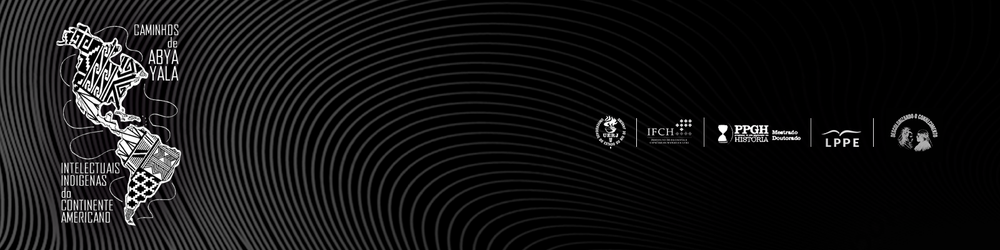

```{r, fig.align = "center", out.height = "200px", echo = FALSE}
knitr::include_graphics(sub("\\.Rmd$", ".jpeg", knitr::current_input()))
```

Sindri Tatiana González Ipuana é empreendedora e artesã do povo Wayuu, que se organiza em subdivisões conhecidas como clãs. Sindri faz parte do clã Ipuana. Ela nasceu em Alta Guajira, que pertence ao município de Uribia, e é considerada uma capital indígena na Colômbia, localizada no norte do país, precisamente na região da Guajira. Desde muito jovem, como é costume entre os wayuu, Sindri aprendeu a arte da tecelagem, inicialmente para uso pessoal e depois como fonte de renda. Identificou uma oportunidade de negócio em sua cultura e se preparou para contribuir com seu conhecimento para a comunidade Wayuu, focando em melhorar a qualidade de vida dos artesãos.

Sindri lidera a empresa Akumaja, destacando-se por sua formação no SENA (Servicio Nacional de Aprendizaje) em escalado e patronagem de roupas femininas e em tecnologia em gestão de mercados. É capacitada pela Quality Fórum em Gerenciamento de Sistemas de Gestão Integral e Modelos de Excelência, bem como pelo Programa Prepárese Para Exportar da PROCOLOMBIA.

Com experiência comercial desde 2012, iniciou suas vendas em Santa Marta, cidade localizada no departamento norte da Colômbia, onde adquiriu conhecimentos e participou de eventos governamentais. Contratada pela união temporal YANAMA, elaborou uniformes em Riohacha e mantas para a IPS ANASWAYUU. Atualmente, gerencia 45 artesãos, mantém relações comerciais com professores e turistas e é reconhecida por produtos que se destacam por preservar técnicas ancestrais wayuu e promover a simplicidade na moda. Seu propósito como representante da Akumaja é oferecer produtos que reflitam a cultura Wayuu sem impactar o ecossistema, explorando o processo de produção 100% manual.

## Povo Wayuu 

O povo Wayuu, também conhecido como Guajiro, é um grupo étnico indígena que reside na península de La Guajira, situada no extremo norte da Colômbia e no noroeste da Venezuela. Essa comunidade distinta é reconhecida por sua rica cultura, língua própria e tradições singulares.

Os wayuu falam o wayuunaiki, uma língua arawak que desempenha um papel vital na transmissão de tradições e conhecimentos entre gerações. Eles estão organizados em clãs e famílias extensas, chamadas de rancheiras. Cada clã é liderado por um chefe, chamado de uriana. A estrutura social é centrada na família, fundamentada no respeito mútuo e na colaboração.

Entre os Wayuu, existe a autoridade tradicional e um sistema autóctone de administração da justiça, no qual se destaca o pütchipü ou pütche'ejachi, o portador da palavra, responsável por resolver conflitos entre clãs diferentes. A família é estendida e matrilinear. É o alaula, o tio materno mais velho, que exerce autoridade. Existem pelo menos 30 clãs, entre os quais estão o Ulewana, o Epieyú, o Uriana, o Ipuana, o Pushaina, o Epinayú, o Jasayú, o Arpushana, o Jarariyú, o Wouriyú, o Urariyú, o Sapuana, o Jinnu, o Sijona, o Pausayú, o Uchayarwor'u, o Uriyú, o Warpushana, o Wor, o Pipishana e o Toctouyú. A maior parte da população está nos clãs Epieyú, Uriana e Ipuana.

A economia tradicional dos Wayuu baseia-se em atividades como a pesca, a criação de gado, a agricultura e o artesanato. As famosas "mochilas Wayuu", bolsas coloridas tecidas à mão, são emblemas de sua rica herança artística e criativa, muitas vezes representando uma fonte significativa de renda.

Enfrentando desafios contemporâneos, como questões relacionadas à terra, acesso à educação e à saúde, os wayuu também lidam com os impactos da mudança climática em suas práticas agrícolas e de subsistência. A exploração de recursos naturais, como a mineração, levanta preocupações sobre a preservação do meio ambiente e a sustentabilidade da comunidade.

Apesar desses desafios, o povo Wayuu tem ganhado reconhecimento internacional por sua rica herança cultural. Festivais, como o “Festival de la Cultura Wayuu”, na Colômbia, destacam a música, a dança, a arte e as tradições culinárias únicas da comunidade, proporcionando uma plataforma para compartilhar e preservar sua cultura.

**Texto elaborado por Bernardo Barreto Mattos e Marcos Gabriel Pita da Costa**

:::: {.linkbox}
Ouça a entrevista completa:

::: {.icons}
[](https://youtu.be/X8mUzWA2ePY?si=Gc_foV_uh8NS4SXD) [](https://open.spotify.com/episode/3sEr5BmNEdjCdUu9qdWHwt?si=llj-hqwNQCWeO9Vi8AyEtQ&nd=1&dlsi=a5e3b39b1f0a488d)
:::
::::

```{r, fig.align = "center", echo = FALSE}

```